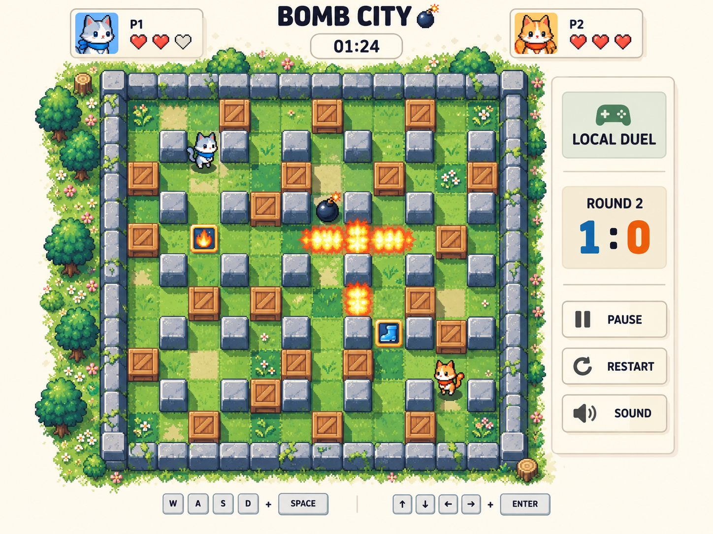

# 炸弹迷城 · 美术改版素材

供 AI Studio 读取和接入的炸弹人游戏美术资源。所有素材平铺在仓库根目录，没有压缩包或子目录。

## 先看这三个文件

1. [目标参考图](改版目标参考图.png)：画面风格、布局、配色和角色比例。
2. [给 Studio 的改版指令](给Studio的改版指令.md)：可以直接复制的完整制作要求。
3. [素材说明及来源](素材说明.md)：各套素材的用途、许可、署名与接入说明。

参考图由 AI 生成，是视觉概念，不是已经改好的游戏截图，也不是从本仓库免费素材直接拼出的效果。请以游戏代码确定地图、碰撞和伤害规则。

## 素材导航

| 系列 | 文件 | 用途 |
|---|---|---|
| Bomb Party | [完整精灵表](bomb_party_v4.png) | 炸弹人角色、场景及爆炸素材 |
| Tiny Dungeon | [样例](kenney_tiny-dungeon__Sample.png) · [总览](kenney_tiny-dungeon__Preview.png) · [图块表](kenney_tiny-dungeon__Tilemap__tilemap.png) | 地牢主题备选素材 |
| Pixel Adventure UI | [样例](kenney_ui-pack-pixel-adventure__Sample.png) · [总览](kenney_ui-pack-pixel-adventure__Preview.png) | 按钮、面板与界面装饰 |

独立图片的文件名保留来源与原目录前缀，避免同名冲突。Tiled示例内的图片路径已经同步调整。

- [机器可读素材索引](assets-manifest.json)：名称、类型、大小、系列。
- [原文件名对应关系](文件名对应表.json)。

## 给 Studio 的简短任务

先读取本仓库的改版指令、素材说明和素材索引，再查看参考图与各套素材预览。选择一致的美术路线，将需要的文件下载到项目内，制作可试玩版本。用实际运行截图核对效果，并验证原有玩法。

## 来源与许可

- [Bomb Party — the complete set](https://opengameart.org/content/bomb-party-the-complete-set)：CC-BY 3.0。署名：Original Bomb Party sprite sheet by Matt Hackett of Lost Decade Games, expanded by Cem Kalyoncu and /usr/share. 本仓库保持该精灵图未编辑。
- [Kenney Tiny Dungeon](https://kenney.nl/assets/tiny-dungeon)：CC0，见 [原许可](kenney_tiny-dungeon__License.txt)。
- [Kenney UI Pack — Pixel Adventure](https://kenney.nl/assets/ui-pack-pixel-adventure)：CC0，见 [原许可](kenney_ui-pack-pixel-adventure__License.txt)。

参考图及制作说明不代表第三方素材作者的作品或背书。各资源分别适用自己的许可；付费素材没有收录。
